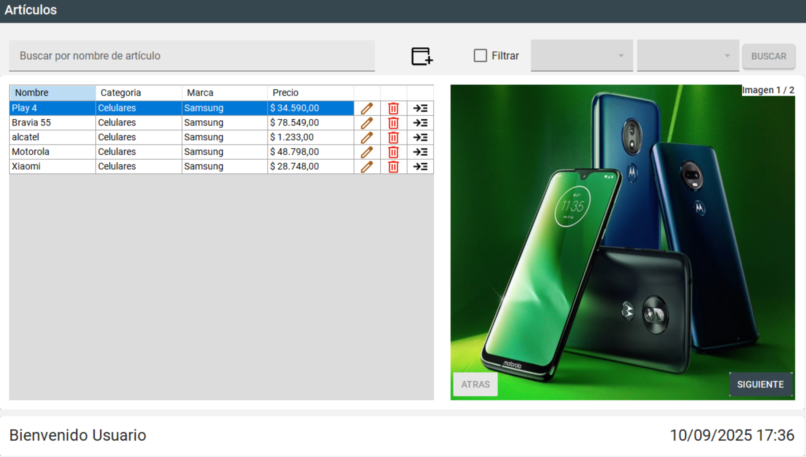
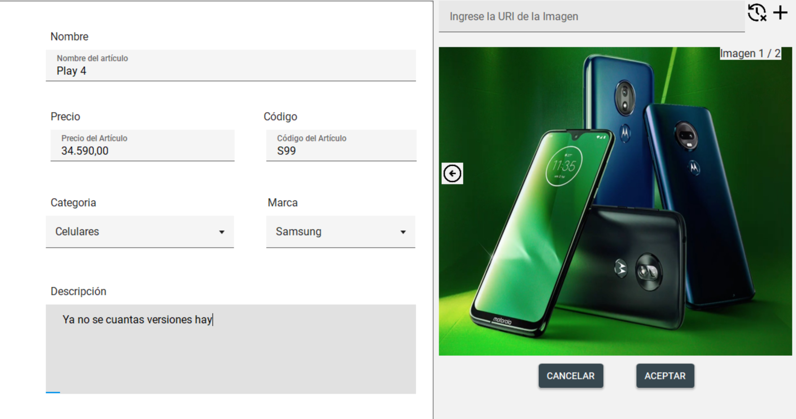
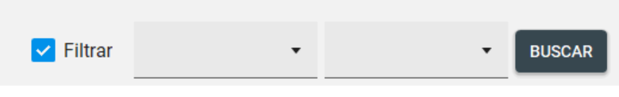
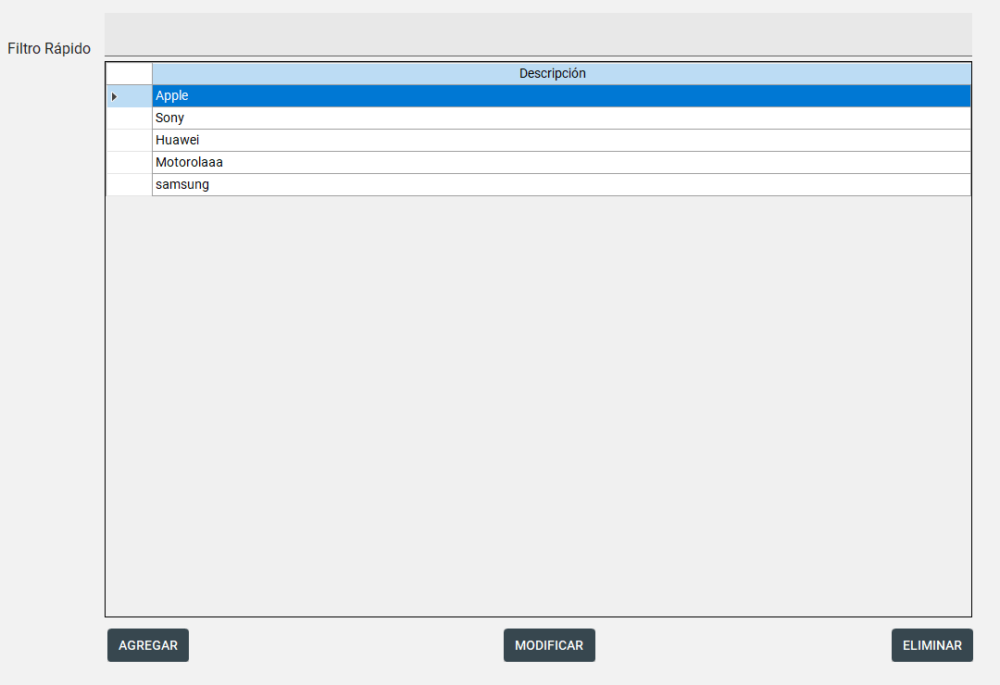
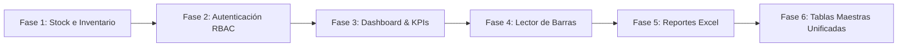

 
 
 
  

Aplicación de escritorio **WinForms** para la gestión de artículos de un catálogo de comercio, desarrollada con **.NET Framework 4.8** y **C#**.  
La aplicación implementa **arquitectura en capas**, manejo de excepciones y validaciones, con persistencia de datos en base de datos mediante **ADO.NET**.  

### Funcionalidades principales
- Listado de artículos  
- Búsqueda por distintos criterios  
- Agregar, modificar y eliminar artículos
- Agregar, modificar y eliminar marcas
- Agregar, modificar y eliminar categorías  
- Ver detalle de un artículo  
- Persistencia en base de datos existente 

=======
# Sistema de Gestión de Artículos e Inventario


-blueviolet?style=for-the-badge)

Aplicación de escritorio corporativa desarrollada en **C# (.NET Framework 4.8)** con **Windows Forms** y una interfaz moderna bajo lineamientos de **Material Design** (*MaterialSkin 2*). Diseñada como una solución ágil y escalable para la administración centralizada de catálogos comerciales, gestión de artículos, precios, marcas, categorías y control de inventario para comercios mayoristas y minoristas (ferreterías, repuestos, bazares y tiendas departamentales).

---

## 📸 Capturas del Sistema

| Catálogo General & Galería | Alta / Edición con Vista Previa |
| :---: | :---: |
|  |  |

| Filtros Avanzados Multicriterio | Gestión de Tablas Maestras |
| :---: | :---: |
|  |  |

---

## ✨ Características Principales

### 📦 Gestión Completa de Artículos (CRUD)
- **Registro y Actualización:** Alta y edición de productos con código alfanumérico, denominación, descripción detallada, marca, categoría y fijación de precios en moneda local (`es-AR`).
- **Eliminación Segura:** Confirmación previa a la baja física de productos con integridad referencial.
- **Detalle Rápido:** Tarjeta deslizante (*Card*) con información extendida y ficha técnica del artículo seleccionado sin perder de vista la grilla principal.

### 🖼️ Galería Multimedia & Carrusel Interactivo
- Soporte para **múltiples imágenes por producto** (URLs remotas y rutas locales).
- Visualizador con controles de carrusel (**Anterior / Siguiente**) sincronizado con la selección de la grilla.
- Mecanismo de contingencia con imágenes de reemplazo (*fallback placeholder*) para enlaces caídos o URLs inválidas, evitando congelamientos de interfaz.

### 🔍 Motor de Búsqueda y Filtrado Dual
- **Búsqueda Dinámica en Tiempo Real:** Filtrado instantáneo por nombre mientras se escribe sobre la caja de texto reactiva.
- **Filtros Avanzados Parametrizados:** Búsqueda combinada por campo (`Precio`, `Nombre`, `Código`, `Marca`, `Categoría`) y condición lógica (`Mayor a`, `Menor a`, `Igual a`, `Comienza con`, `Termina con`, `Contiene`) ejecutada de forma segura a nivel de base de datos.
- Botón de limpieza de filtros con restauración de estado predeterminado en un solo clic.

### ⚙️ Administración de Tablas Maestras
- Módulos autónomos para el alta, listado, modificación y eliminación de **Marcas** y **Categorías**.
- Vinculación relacional inmediata reflejada en los selectores del catálogo.

### 🎨 Experiencia de Usuario (UI/UX) Moderna
- Implementación de **MaterialSkin 2** con paleta visual *BlueGrey*, tipografía limpia, sombras suaves y contrastes optimizados.
- Controles personalizados: botones interactivos, cards informativas, animaciones de hover y cursor adaptativo en acciones de grilla.
- **Manual de Usuario Interactivo:** Pestaña embebida con navegador web nativo que renderiza la guía completa del operador con capturas explicativas.

---

## 🏛️ Arquitectura del Sistema

La solución está estructurada siguiendo el patrón de **Arquitectura en Capas (N-Tier Architecture)**, garantizando bajo acoplamiento, alta cohesión y testeabilidad:

```
Sistema-gestion-articulos/
├── Dominio/               # Modelos de Entidad / POCO
│   ├── Articulo.cs        # Entidad principal con formato de moneda localizado
│   ├── Categoria.cs       # Entidad de clasificación
│   ├── Marca.cs           # Entidad de fabricante
│   └── Imagen.cs          # Entidad de recursos multimedia
│
├── Negocio/               # Capa de Lógica de Negocio y Persistencia (DAL/BLL)
│   ├── AccesoDato.cs      # Wrapper ADO.NET: conexión, comandos parametrizados y transacciones
│   ├── ArticuloNegocio.cs # Reglas y consultas seguras (CRUD y filtros avanzados)
│   ├── CategoriaNegocio.cs# Lógica para categorización
│   ├── MarcaNegocio.cs    # Lógica para gestión de marcas
│   └── ImagenNegocio.cs   # Lógica y cascada de imágenes
│
├── Vista/                 # Capa de Presentación (UI WinForms + MaterialSkin 2)
│   ├── Form1.cs           # Pantalla principal con pestañas y navegación
│   ├── Loguin.cs          # Ventana de autenticación / bienvenida
│   ├── frmAgregarArticulo # Formularios modales y embebidos para catálogo
│   ├── frmMarcas / frmCategorias # Gestión de tablas maestras
│   ├── ImagenHelper.cs    # Utilidad de renderizado, carrusel y caché visual
│   ├── InputHelper.cs     # Validaciones centralizadas de formularios y errores
│   └── Resources/         # Recursos gráficos, manual de usuario e info corporativa
│
├── script_db.sql          # Script DDL/DML de base de datos con datos semilla
└── PLAN_MEJORAS.md        # Hoja de ruta estratégica de escalabilidad
```

### 🛡️ Seguridad de Datos y Buenas Prácticas
- **Prevención de Inyección SQL:** Todas las consultas dinámicas y de filtros avanzados están estrictamente parametrizadas mediante `SqlParameter` en `AccesoDato.cs`.
- **Integridad Referencial:** Claves foráneas con borrado en cascada configurado para imágenes vinculadas (`ON DELETE CASCADE`).
- **Separación de Responsabilidades:** La vista desconoce la estructura de las tablas; interactúa únicamente mediante contratos de objetos del `Dominio` a través de los servicios de `Negocio`.

---

## 🛠️ Tecnologías y Herramientas

| Componente | Tecnología |
| :--- | :--- |
| **Lenguaje** | C# 10 / .NET Framework 4.8 |
| **Framework UI** | Windows Forms (WinForms) |
| **Librería de Componentes** | [MaterialSkin 2](https://github.com/leocms/MaterialSkin) |
| **Acceso a Datos** | ADO.NET nativo (`System.Data.SqlClient`) |
| **Base de Datos** | Microsoft SQL Server (LocalDB / Express / Standard) |
| **Control de Versiones** | Git & GitHub |

---

## 🚀 Instalación y Puesta en Marcha

### Prerrequisitos
- **Visual Studio 2019 / 2022** con la carga de trabajo *Desarrollo de escritorio de .NET*.
- **.NET Framework 4.8 SDK**.
- **Microsoft SQL Server** (2016 o superior / SQL Server Express / LocalDB).

### Pasos de Configuración

1. **Clonar el repositorio:**
   ```bash
   git clone https://github.com/SebastianDte/Sistema-gestion-articulos.git
   cd Sistema-gestion-articulos
   ```

2. **Crear y Poblar la Base de Datos:**
   - Abrir **SQL Server Management Studio (SSMS)** o Azure Data Studio.
   - Abrir y ejecutar el archivo `script_db.sql` incluido en la raíz del proyecto.
   - El script creará automáticamente la base de datos `CATALOGO_P3_DB`, sus tablas (`ARTICULOS`, `MARCAS`, `CATEGORIAS`, `IMAGENES`) e insertará los registros de prueba con imágenes.

3. **Verificar Cadena de Conexión:**
   - La cadena por defecto se encuentra configurada en `Negocio/AccesoDato.cs`:
     ```csharp
     conexion = new SqlConnection("server=.\\SQLEXPRESS;database=CATALOGO_P3_DB;integrated security=true");
     ```
   - Si utiliza otra instancia (como `(localdb)\\MSSQLLocalDB` o autenticación SQL), modifique dicha cadena.

4. **Compilar y Ejecutar:**
   - Abrir `UTN_FRGP_ActividadII.sln` en Visual Studio.
   - Restaurar paquetes NuGet (automático al compilar).
   - Presionar `F5` o seleccionar **Iniciar**.

---

## 🗺️ Roadmap y Futuras Mejoras (En Desarrollo)

El sistema se encuentra en un proceso activo de modernización y escalabilidad funcional según lo planificado en [`PLAN_MEJORAS.md`](PLAN_MEJORAS.md):



### 1. Control de Stock e Inventario Crítico
- Incorporación de atributos `Stock` y `StockMinimo` con disparador automático de alertas visuales semafóricas (verde/amarillo/rojo) en la grilla principal.
- Detección proactiva de productos por debajo del punto de reposición.

### 2. Autenticación y Control de Accesos (RBAC)
- Autenticación robusta con contraseñas encriptadas mediante algoritmo criptográfico **SHA-256**.
- Perfiles de usuario diferenciados:
  - **Administrador:** Control total sobre catálogo, precios, inventario y usuarios.
  - **Operador:** Perfil operativo con permisos de consulta y actualización de stock, con bloqueo de eliminación.

### 3. Dashboard Ejecutivo con Métricas de Negocio (KPIs)
- Panel principal con tarjetas de métricas en tiempo real:
  - Total de artículos activos.
  - **Valoración monetaria global del inventario** en moneda local (\$ Precio × Stock).
  - Contador de productos en estado crítico de reposición.
- Diseño responsivo adaptativo para monitores panorámicos (Full HD / 24"+).

### 4. Integración de Lector de Códigos de Barras
- Escaneo rápido vía lectores USB convencionales o dispositivos móviles por Wi-Fi.
- Búsqueda instantánea con tecla de confirmación automática (*Auto-Enter*) y respuesta sonora de validación (*Beep*).

### 5. Reportes Corporativos y Exportación a Excel
- Generación de archivos `.xlsx` nativos mediante ClosedXML/EPPlus sin dependencia de Microsoft Office.
- Reportes automáticos de stock crítico para emisión directa de órdenes de compra a proveedores.

### 6. Unificación de Gestión de Tablas Maestras
- Interfaz unificada por pestañas modales para simplificar la creación y mantenimiento simultáneo de Marcas y Categorías.

---

## 👨‍💻 Autor

Desarrollado de forma integral y autónoma por:

* **Sebastián Duarte**
  * Portfolio / GitHub: [@SebastianDte](https://github.com/SebastianDte)
  * Contacto: [contacto@sebastianduarte.com](mailto:contacto@sebastianduarte.com)
  * Rol: Diseño de Arquitectura, Modelado de Datos y Desarrollo Full Stack (.NET)

---

## 📄 Licencia

Este proyecto se distribuye bajo la licencia **MIT**. Consulte el archivo de licencia correspondiente para más detalles.
>>>>>>> 6a15ddaacecf5e28f0a2adf8bf21a78e67fc9e3e
